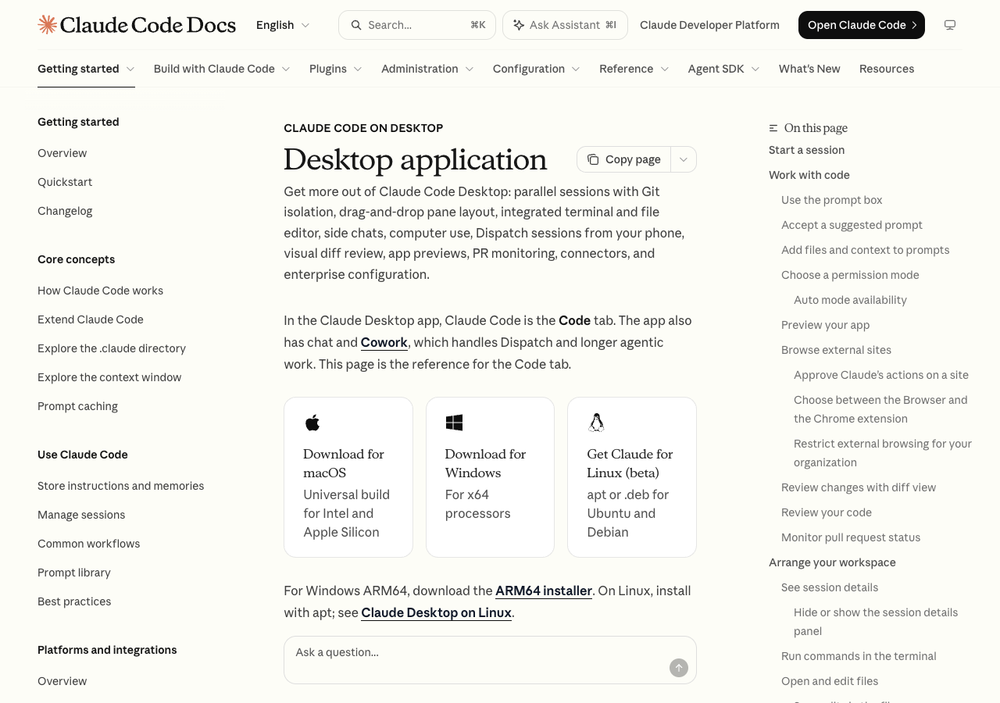
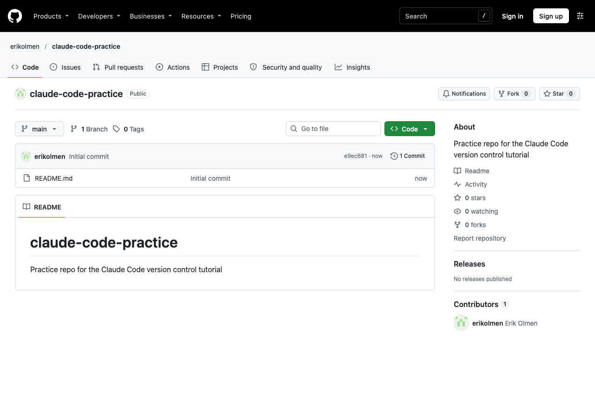
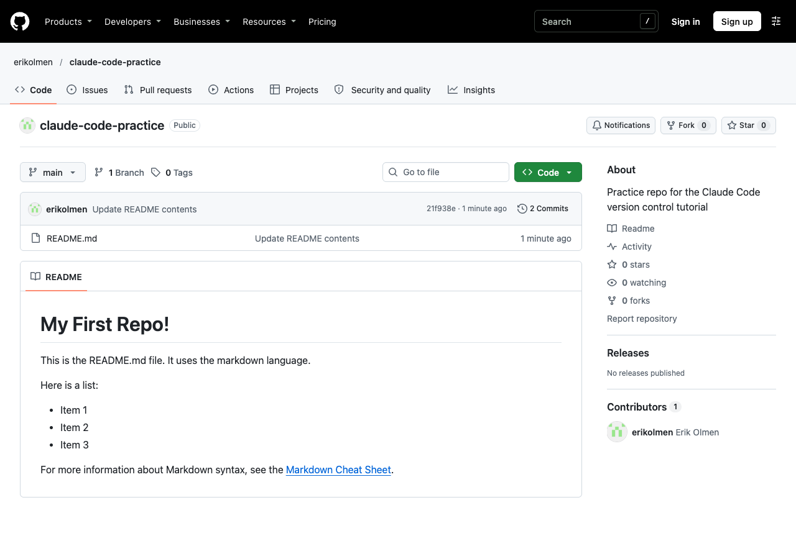
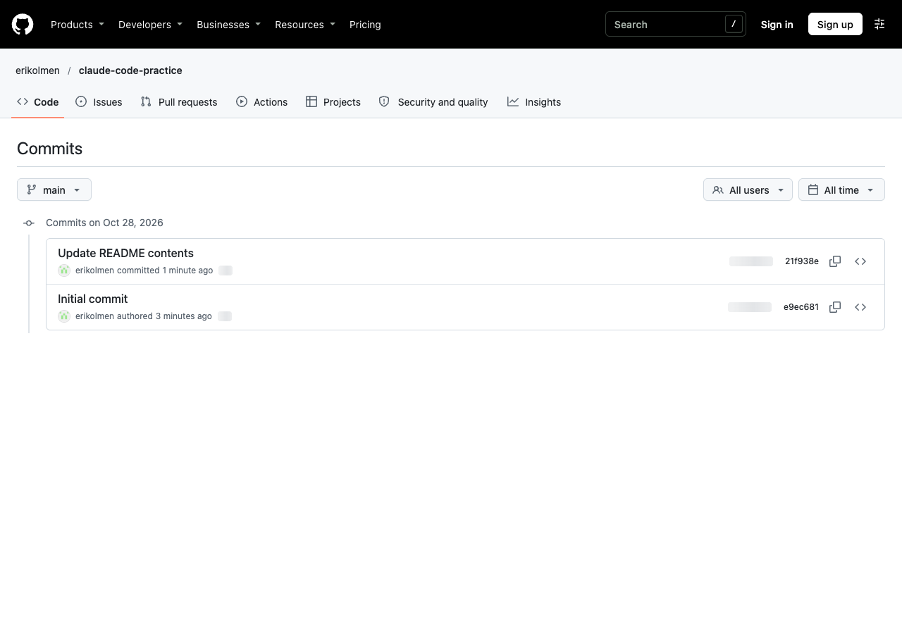
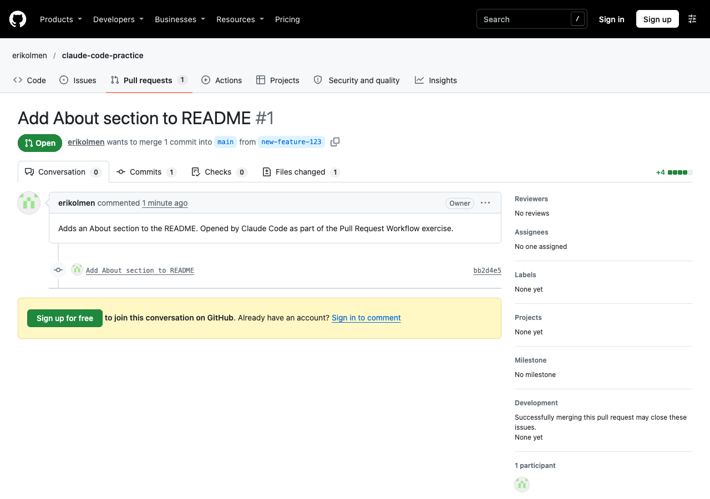
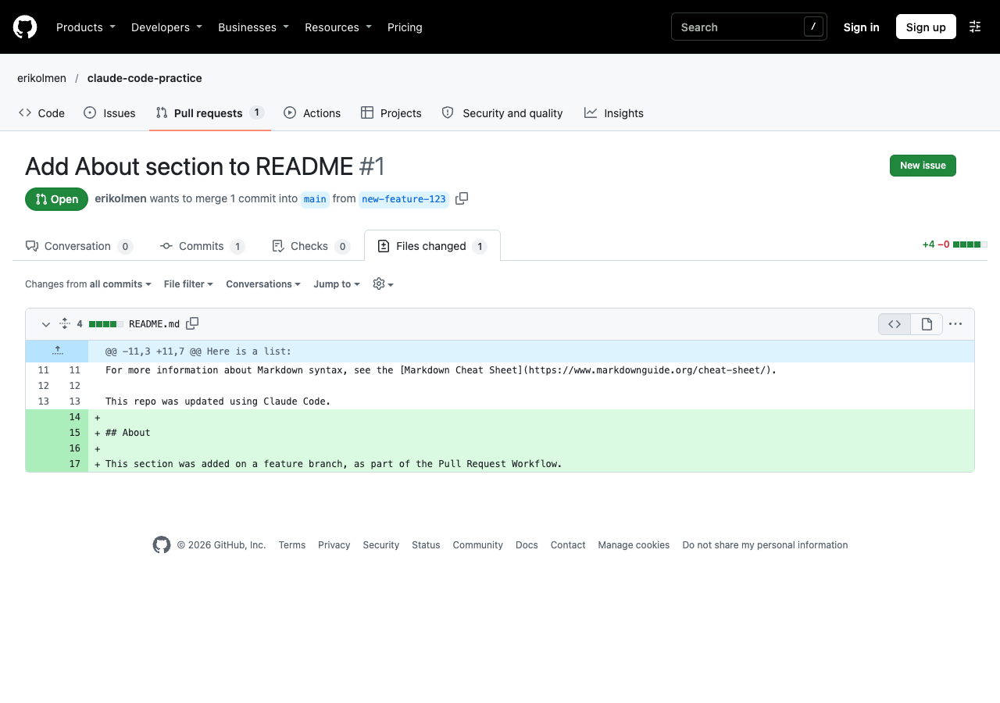
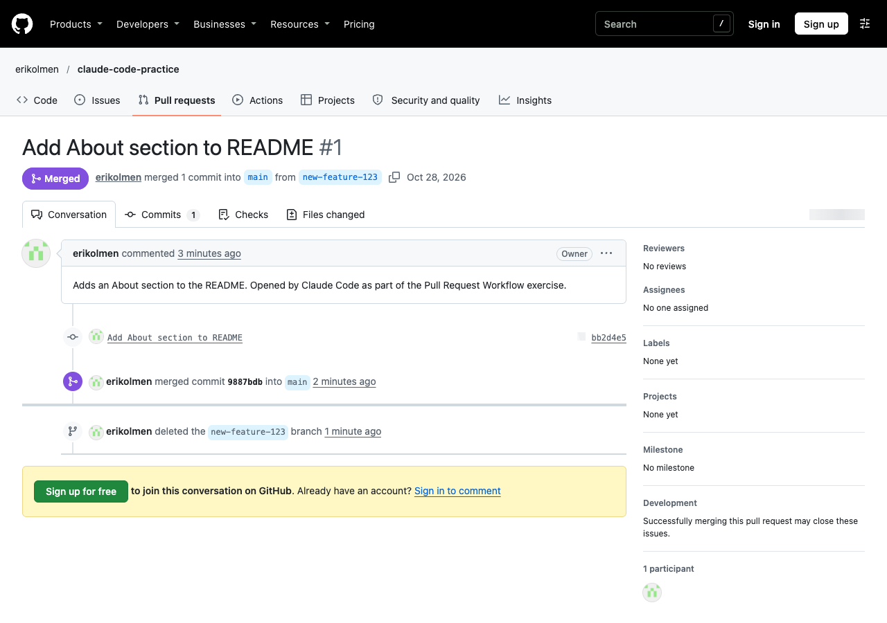

# Claude Code

[Claude Code](https://code.claude.com/docs/en/overview) is an AI coding tool made by Anthropic. It can read the files in a project, make edits, and run commands like `git` and `gh` on our behalf. Instead of typing the commands ourselves, we describe what we want in plain English, and Claude Code runs the commands for us.

In this chapter, we'll use Claude Code to perform the same steps from the [Version Control Workflow](../exercises/1-version-control-workflow/index.qmd) and [Pull Request Workflow](../exercises/2-pull-request-workflow/index.qmd) exercises. You are encouraged to complete those exercises first (using GitHub Desktop), so you are familiar with the steps before letting an AI tool perform them.

> FYI: Claude Code requires a paid Claude subscription (e.g. Claude Pro). See the [pricing page](https://claude.com/pricing) for more information.

## References

Official References:

  + [Claude Code Docs](https://code.claude.com/docs/en/overview)
  + [Claude Code Desktop App Docs](https://code.claude.com/docs/en/desktop)
  + [Claude Code Setup Guide](https://code.claude.com/docs/en/setup)

Related References:

  + [GitHub CLI Docs](https://cli.github.com/manual/)

## Installation

Claude Code is available as a desktop application (the "Code" tab of the Claude app), and as a command-line utility (the `claude` command). Beginners are encouraged to use the desktop application, which is what we'll use in the rest of this chapter. Users who are comfortable with the command-line may prefer the command-line utility instead.

### Installing the Desktop App (Mac and Windows)

Download the Claude desktop app from the [Claude Code desktop docs](https://code.claude.com/docs/en/desktop).

On Mac, open the downloaded file, and drag the Claude app into your "Applications" folder. On Windows, run the downloaded installer.

> NOTE: Claude Code uses Git to perform version control operations, so make sure you have [installed Git](./clis/git.qmd) as well. Windows users are recommended to install Git for Windows (which includes Git Bash), so Claude Code can use it to run commands.



### Installing the Command-line Utility (Optional)

First see if the command-line utility is already installed:

```sh
# Mac OS:
which claude

# Windows OS:
where claude
```

If this command produces a filepath-looking output, the command-line utility is already installed, and you can skip down to the "Configuration" section.

Otherwise, if you'd like to use the command-line utility instead, you can install it via Node.js (Mac or Windows), or via [Homebrew](./clis/brew.qmd) (Mac only):

```sh
# via Node.js (requires Node.js version 22 or later):
npm install -g @anthropic-ai/claude-code

# via Homebrew (Mac only):
brew install --cask claude-code
```

> FYI: the [official setup guide](https://code.claude.com/docs/en/setup) also provides a one-line install command for Mac and Windows, which doesn't require Node.js or Homebrew.

After installing, restart your terminal application, where you should now be able to check the version:

```sh
claude --version
```

## Configuration

### Logging In

Open the Claude app, and login with your Claude account. Then click on the "Code" tab.

> FYI: if using the command-line utility, the first time you run the `claude` command it will open a browser window, where you can login with your Claude account.

### Connecting to GitHub

Claude Code uses the Git installed on your computer, so it will push and pull using the same GitHub credentials Git already uses.

To create repositories and open pull requests, Claude Code also needs the [GitHub CLI](https://cli.github.com/) (`gh`).

Mac users can install the GitHub CLI via [Homebrew](./clis/brew.qmd):

```sh
brew install gh
```

Windows users can install the GitHub CLI via the installer on the [GitHub CLI website](https://cli.github.com/), or via the `winget` command:

```sh
winget install --id GitHub.cli
```

After installing the GitHub CLI, restart your terminal application, then login with your GitHub account, and follow the prompts:

```sh
gh auth login
```

Verify you are logged in:

```sh
gh auth status #> ✓ Logged in to github.com account YOUR_USERNAME
```

### Permissions

Claude Code can ask for permission before editing files or running commands. Beginners are encouraged to choose the "Manual" permission mode (using the mode selector, below the prompt box), so you can review each change and command before it happens.

## Usage

To start a session, use the project folder selector (below the prompt box) to choose the folder of the repository you want to work on. Then type your requests into the prompt box.

As Claude Code works, each command it runs shows up as a step in the conversation. Click on a step to see the exact command and its output. You can also click the "Changes" button at the top of the window to review changes to each file (similar to the "Changes" tab in GitHub Desktop), or click the "Terminal" button to run Git commands yourself.

### Version Control Workflow

These steps correspond with the [Version Control Workflow](../exercises/1-version-control-workflow/index.qmd) exercise.

#### Creating a Repository

Ask Claude Code to create a new repository on GitHub and clone it, for example: "Create a new public GitHub repo called claude-code-practice with a README, and clone it to my Desktop".

Claude Code will run a command like:

```sh
gh repo create claude-code-practice --public --add-readme --clone
```

> NOTE: alternatively, you can create the repository via the GitHub website, and clone it yourself, like you did in the original exercise.



#### Editing a File

Ask Claude Code to edit the README file, for example: "Update the README to have a heading called My First Repo, a sentence saying it uses markdown, a list of three items, and a link to the Markdown Cheat Sheet".

Click the "Changes" button to review the changes.

#### Committing Changes

Ask Claude Code to commit the changes, for example: "Commit this change with the message Update README contents".

Claude Code will run commands like:

```sh
git add README.md # stages the changes to the README file
git commit -m "Update README contents" # saves a new version, with the given message
```

#### Pushing Changes

Ask Claude Code to push the changes to GitHub, for example: "Push the changes to GitHub".

Claude Code will run a command like:

```sh
git push origin main # uploads the new commit(s) to the main branch on GitHub
```

After pushing, visit the repository on GitHub, where you should see the updated README file:



You should also see the new commit in the repository's commit history:



Repeat the editing, committing, and pushing steps at least one more time for good measure.

### Pull Request Workflow

These steps correspond with the [Pull Request Workflow](../exercises/2-pull-request-workflow/index.qmd) exercise, using the same repository.

#### Updating the Main Branch

Ask Claude Code to make sure the local main branch is up to date, for example: "Checkout the main branch and pull the latest changes".

Claude Code will run commands like:

```sh
git checkout main # switches to the main branch
git pull origin main # downloads any new changes from the main branch on GitHub
```

#### Creating a Feature Branch

Ask Claude Code to create a new branch, make a change, and commit it, for example: "Create a new branch called new-feature-123, add an About section to the README, and commit the change".

Claude Code will run commands like:

```sh
git checkout -b new-feature-123 # creates and switches to a new branch

# (edits the README file)

git add README.md
git commit -m "Add About section to README"
```

#### Opening a Pull Request

Ask Claude Code to push the branch and open a pull request, for example: "Push this branch to GitHub and open a pull request".

Claude Code will run commands like:

```sh
git push -u origin new-feature-123 # uploads the feature branch to GitHub

# opens a pull request to merge the feature branch into the main branch:
gh pr create --base main --head new-feature-123 --title "Add About section to README"
```

Visit the pull request on GitHub:



Click on the "Files changed" tab to review the changes, and optionally leave some comments:



#### Merging the Pull Request

When you are satisfied with the changes, click the "Merge pull request" button on GitHub, like you did in the original exercise.

> FYI: you can also ask Claude Code to merge the pull request for you (e.g. "Merge the pull request and update my local main branch"), in which case it will use the `gh pr merge` command.



To repeat the process, start again from the "Updating the Main Branch" step.

## Success Criteria

If successful, you should be able to use Claude Code to commit and push changes to a GitHub repository, as well as to open a pull request from a feature branch.

### Tips and Tricks (Optional)

  + If you're not sure what a command does, ask Claude Code to explain it (e.g. "What does git pull do?").
  + Be specific about the branch names, commit messages, and files you want, so Claude Code does exactly what you expect.
  + Click on each step to see which Git commands were run. The goal is to learn the workflow, not just to get it done!
